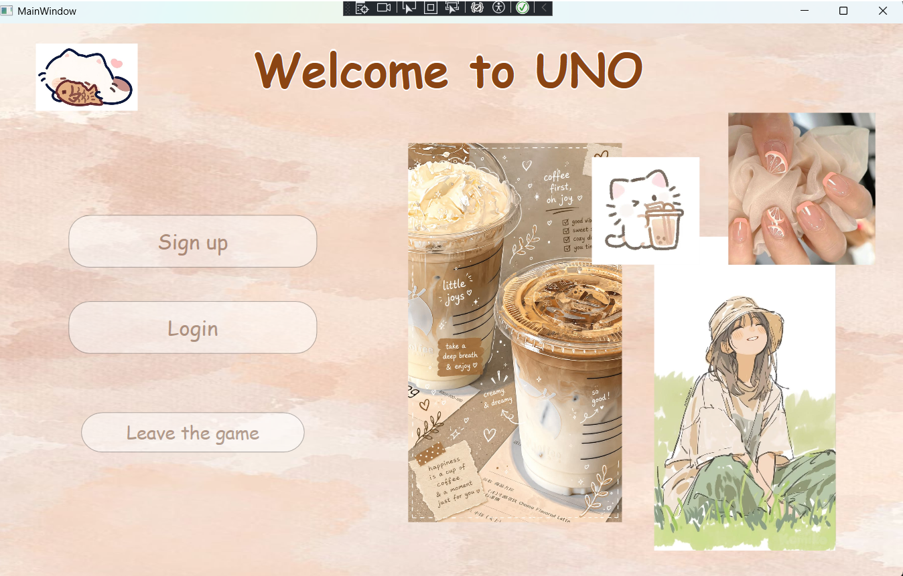
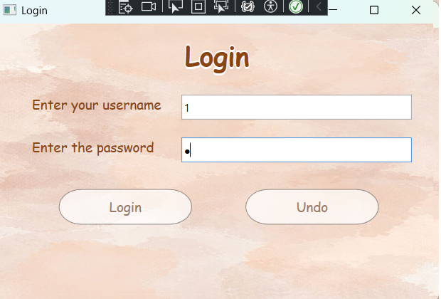
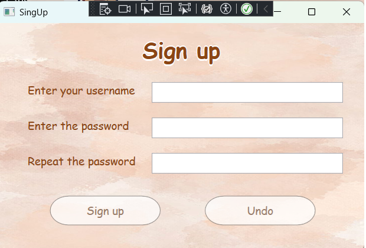
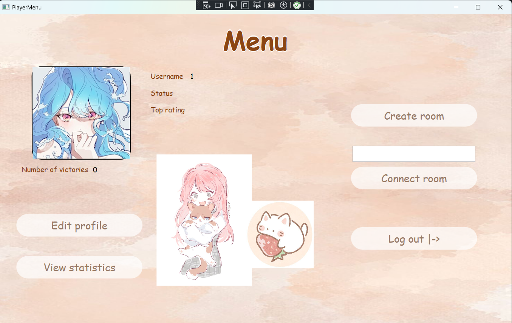
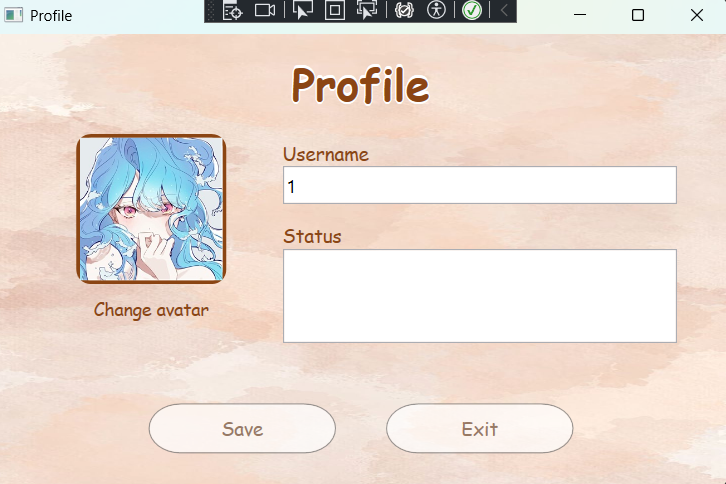
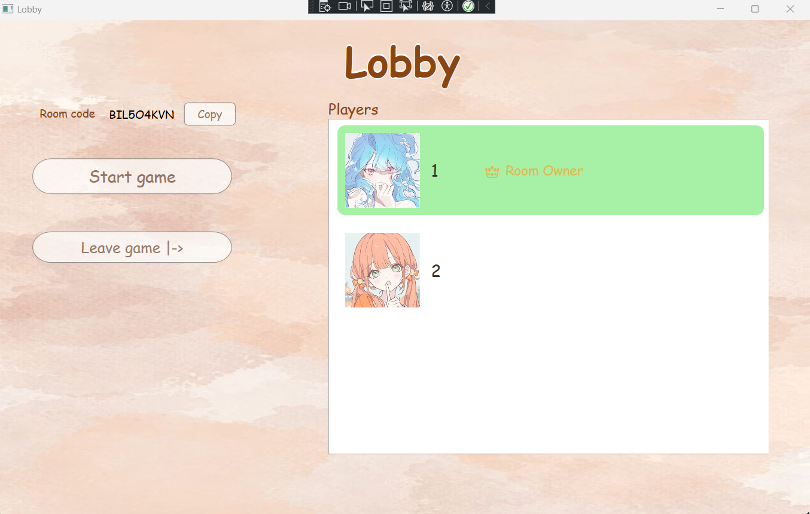
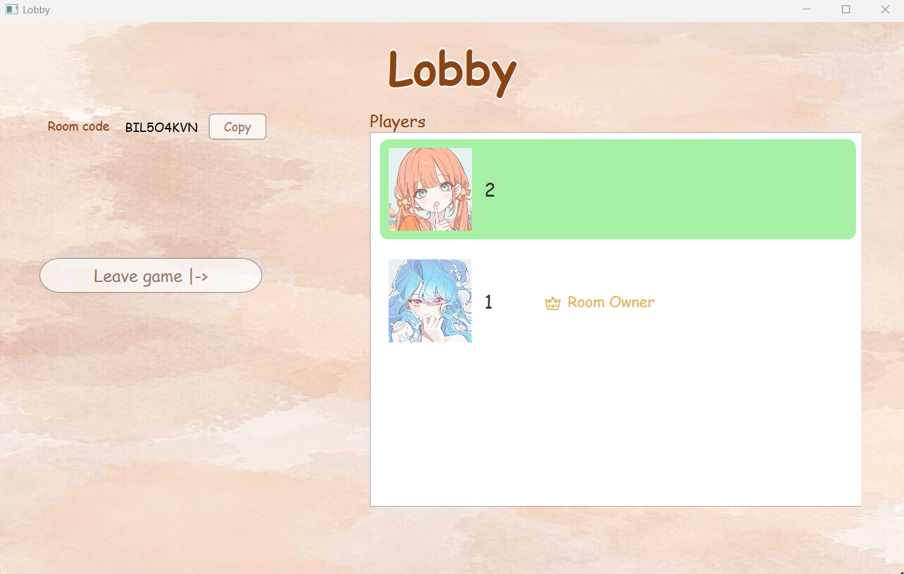
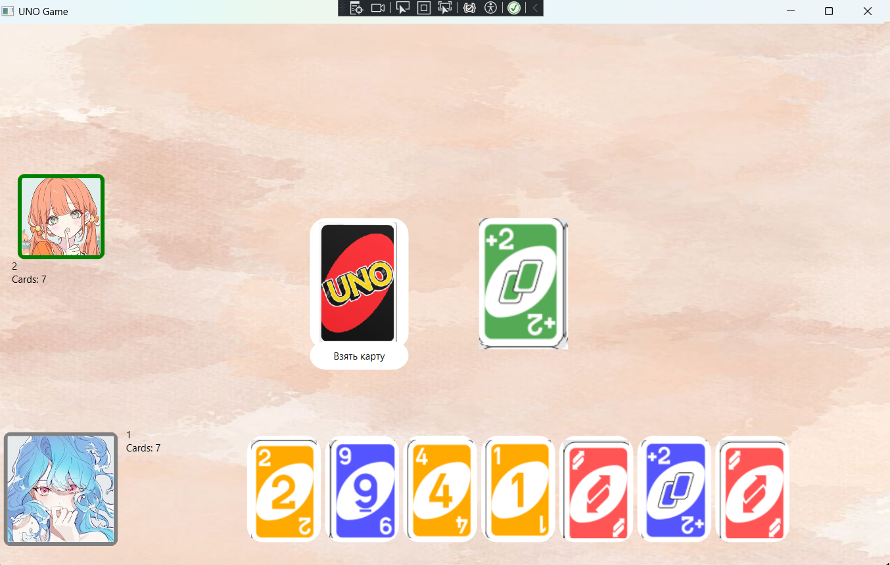
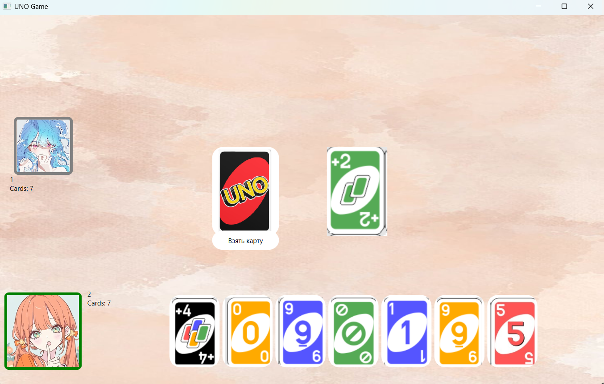
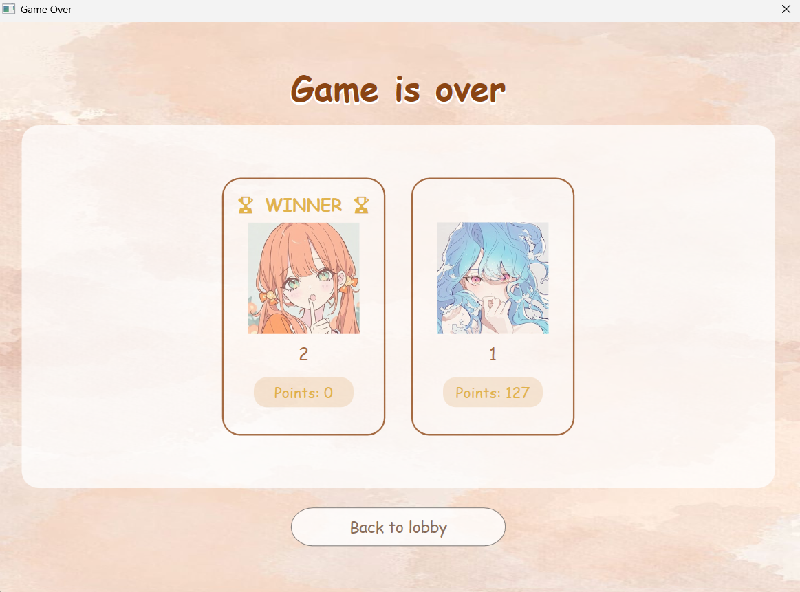

# UNO — многопользовательская карточная игра

UNO — настольное приложение для игры в классическую карточную игру UNO по сети. Проект состоит из WPF-клиента, серверного приложения на C# и общей библиотеки с моделями и сетевыми сообщениями.

Игроки могут создавать игровые комнаты, приглашать других участников по коду комнаты и играть друг против друга. Сервер обрабатывает игровые действия и рассылает клиентам актуальное состояние партии.

## Содержание

- [Возможности](#возможности)
- [Технологический стек](#технологический-стек)
- [Архитектура](#архитектура)
- [Как работает взаимодействие](#как-работает-взаимодействие)
- [Игровая логика](#игровая-логика)
- [Структура решения](#структура-решения)
- [Требования](#требования)
- [Настройка и запуск](#настройка-и-запуск)
- [Запуск сервера в Docker](#запуск-сервера-в-docker)
- [Скриншоты](#скриншоты)

## Возможности

- Регистрация и вход в учётную запись.
- Профиль игрока: имя, статус и аватар.
- Создание игровой комнаты и подключение к ней по уникальному коду.
- Поддержка от 2 до 4 игроков в одной комнате.
- Отображение участников комнаты и игрового состояния.
- Передача игровых действий между клиентами в реальном времени через WebSocket.
- Реализация основных типов карт UNO: числовых, пропуска хода, смены направления, «+2», смены цвета и «+4».
- Объявление UNO.
- Подсчёт очков, количества сыгранных партий и побед.
- Хранение учётных записей и статистики в PostgreSQL.

## Технологический стек

| Компонент | Технологии |
|---|---|
| Клиент | C#, .NET 10, WPF, XAML, MVVM-подход |
| Сервер | C#, .NET 8, `HttpListener`, WebSocket |
| Сетевой обмен | WebSocket, JSON, `System.Text.Json` |
| Общие модели | C# Class Library |
| База данных | PostgreSQL, Npgsql |
| Контейнеризация | Docker |

## Архитектура

Решение разделено на три проекта.

```text
UNO/
├── ClientUNO/          # WPF-клиент
├── ServerUNO/          # Сервер и игровая логика
│   ├── Database/       # Работа с PostgreSQL
│   ├── Dockerfile
│   ├── GameEngine.cs   # Правила и состояние игры
│   ├── GameRoom.cs     # Игровая комната
│   ├── RoomManager.cs  # Создание комнат и подключение игроков
│   └── ServerManager.cs# WebSocket-сервер
└── Shared_Library/    # Общие модели и сетевые сообщения
```

### ClientUNO

WPF-приложение отвечает за пользовательский интерфейс и взаимодействие с сервером. Клиент устанавливает WebSocket-соединение, отправляет сообщения с действиями игрока и обрабатывает ответы сервера.

Основные части:

- `GameClient` — отправка и получение WebSocket-сообщений, преобразование JSON в типизированные сообщения.
- `GameViewModel` — логика представления и команды интерфейса.
- `AppSession` — общая сессия клиента.
- XAML-окна — авторизация, регистрация, лобби, профиль и игровой экран.

### ServerUNO

Сервер принимает WebSocket-подключения, обрабатывает входящие сообщения и управляет игровыми комнатами.

Основные классы:

- `ServerManager` — запускает WebSocket endpoint `http://+:5000/ws/` и принимает подключения.
- `ClientConnection` — представляет подключённого клиента и обеспечивает обмен сообщениями.
- `RoomManager` — создаёт комнаты, проверяет коды и управляет подключением игроков.
- `GameRoom` — хранит участников комнаты и координирует ход партии.
- `GameEngine` — реализует правила UNO, проверку ходов, раздачу карт и подсчёт результатов.
- `AccountManager` и классы из `Database/` — взаимодействуют с PostgreSQL.

### Shared_Library

Общая библиотека используется клиентом и сервером. В ней находятся модели карт и игроков, а также классы сообщений, которыми обмениваются приложения. Это позволяет использовать одинаковые структуры данных на обеих сторонах соединения.

## Как работает взаимодействие

1. Клиент подключается к серверу по WebSocket.
2. Игрок регистрируется или входит в существующую учётную запись.
3. При создании комнаты сервер генерирует уникальный код. Другие игроки используют этот код для подключения.
4. После начала партии сервер создаёт игровое состояние и отправляет каждому участнику персональное состояние игры.
5. Когда игрок выполняет действие, клиент отправляет соответствующее JSON-сообщение серверу.
6. Сервер проверяет действие, обновляет игровую логику и рассылает актуальное состояние участникам комнаты.

Для сетевого обмена используются типизированные сообщения, например `LoginMessage`, `CreateRoomMessage`, `ConnectMessage`, `PlayCardMessage`, `TakeCardMessage`, `PushUNOMessage` и `GameStateMessage`.

## Игровая логика

Игровая логика выполняется на сервере. В `GameEngine` хранятся колода, карты игроков, верхняя карта сброса, текущий цвет, направление и индекс игрока, чей сейчас ход.

- При старте партии каждому игроку раздаётся по 7 карт.
- Используется колода из 108 карт.
- Сервер проверяет допустимость разыгрываемой карты.
- Карты действий изменяют ход игры: пропускают следующего игрока, меняют направление или заставляют взять дополнительные карты.
- При розыгрыше чёрной карты игрок выбирает цвет.
- При завершении партии рассчитываются очки оставшихся на руках карт и обновляется статистика игроков.

## Требования

Для локального запуска понадобятся:

- Windows — для запуска WPF-клиента.
- .NET SDK 10 — для сборки клиента.
- .NET SDK 8 — для сборки сервера и общей библиотеки.
- PostgreSQL.
- Visual Studio 2022 с компонентом разработки приложений .NET для Windows (WPF) либо соответствующие инструменты .NET SDK.

## Настройка и запуск

### 1. Подготовка базы данных

Создайте базу данных `UnoDB` в PostgreSQL:

```sql
CREATE DATABASE "UnoDB";
```

Внутри неё создайте таблицу пользователей. Схема ниже соответствует полям, которые использует `AccountManager`:

```sql
CREATE TABLE users (
    id UUID PRIMARY KEY,
    username TEXT NOT NULL UNIQUE,
    passwordhash TEXT NOT NULL,
    name TEXT NOT NULL,
    status TEXT NOT NULL DEFAULT '',
    avatarid INTEGER NOT NULL DEFAULT 1,
    wins INTEGER NOT NULL DEFAULT 0,
    countgames INTEGER NOT NULL DEFAULT 0
);
```

> Имена таблицы и столбцов указаны в нижнем регистре, поскольку SQL-запросы приложения используют идентификаторы без кавычек, а PostgreSQL приводит такие имена к нижнему регистру.

### 2. Настройка подключения к PostgreSQL

В текущей версии строка подключения находится в исходном коде серверной части (`AccountManager.cs` и `Database/Database.cs`). Перед запуском укажите параметры своего экземпляра PostgreSQL.

**Важно:** не публикуйте пароли и другие секреты в GitHub. Для публичной версии проекта строку подключения следует вынести в переменные окружения или конфигурацию, не попадающую в систему контроля версий.

### 3. Запуск сервера

Из корневой папки репозитория выполните:

```bash
dotnet restore ServerUNO/ServerUNO.csproj
dotnet run --project ServerUNO/ServerUNO.csproj
```

Сервер принимает WebSocket-подключения по адресу:

```text
ws://localhost:5000/ws/
```

### 4. Запуск клиента

Откройте `ClientUNO/ClientUNO.csproj` в Visual Studio и запустите проект. В текущей конфигурации клиент подключается к `ws://localhost:5000/ws/`, поэтому сервер должен быть запущен на той же машине.

Если сервер размещён на другом компьютере или серверном хосте, измените адрес подключения в `ClientUNO/App.xaml.cs` на адрес этого сервера. Убедитесь, что порт 5000 доступен по сети и правила межсетевого экрана разрешают соединение.

## Запуск сервера в Docker

В репозитории есть `ServerUNO/Dockerfile` для сборки серверного приложения. Команду сборки нужно выполнять из корневой папки репозитория, так как Dockerfile копирует корневой контекст сборки:

```bash
docker build -f ServerUNO/Dockerfile -t uno-server .
```

Запуск контейнера:

```bash
docker run --name uno-server -p 5000:5000 uno-server
```

Этот Dockerfile контейнеризирует серверное приложение. PostgreSQL в него не включён: база данных должна быть запущена отдельно, а строка подключения сервера должна указывать на доступный из контейнера адрес БД. Значение `localhost` внутри контейнера указывает на сам контейнер, а не на хост-машину или другой контейнер.

## Скриншоты


### Авторизация и регистрация





### Меню игрока и профиль




### Лобби




### Игровой процесс





---

Проект создан в учебных и портфолио-целях для практики разработки клиент-серверных приложений на C#, сетевого взаимодействия через WebSocket и работы с PostgreSQL.
